# Saito Builder

A configuration-driven, multi-tenant **static website factory**. Each website is a YAML file that overrides a versioned template; one Astro renderer turns every site into static HTML for a CDN. Product brief: [STORY.md](STORY.md).

Read top to bottom: each section zooms in one level.

| Level | Section | Answers |
|---|---|---|
| 1 | [Overview](#1-overview) | What is this, who uses it, what does it talk to? |
| 2 | [Architecture](#2-architecture) | What are the parts, and how does a site get resolved? |
| 3 | [Workflows](#3-workflows) | How do I create sites, add templates and change them? |
| 4 | [Build and deployment](#4-build-and-deployment) | How does a site reach the CDN? |
| 5 | [Operations](#5-operations) | Commands, environments, security, reference |

---

## 1. Overview

### Scope

| In scope | Out of scope |
|---|---|
| Content and marketing sites: landing, corporate, campaign, restaurant, event, microsites | ERP, CRM, SaaS products, dashboards, marketplaces |
| Contact forms through the optional API | User accounts, search, real-time features |
| Light commerce delegated to Snipcart, Shopify or Commerce Layer | Checkout, payments, inventory |
| Any change expressible as section data and theme tokens | Bespoke layouts (need a new section type or template) |

### System context

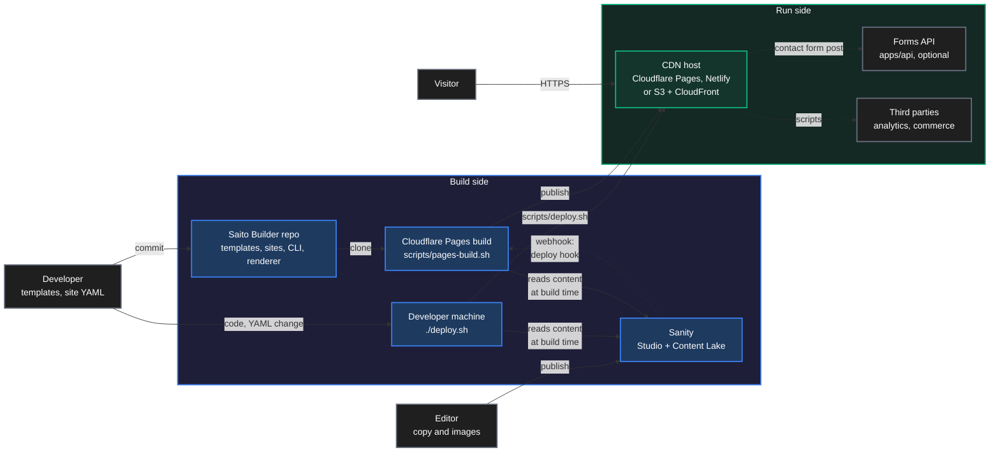

### Quick start

```bash
npm install                                    # npm workspaces, Node >= 20.11
npm test                                       # unit + API tests
npm run saito -- sites                         # list sites
npm run saito -- templates                     # browse the template marketplace
npm run saito -- validate --all                # check every site against its template
npm run saito -- dev acme-corp                 # live preview at http://localhost:4321
npm run saito -- build --all                   # static output in dist/development/<site>
npm run saito -- create globex --template corporate --tenant globex --name "Globex" --url https://globex.example
npm run saito -- outdated                      # sites that can move to a new template major
npm run saito -- upgrade acme-launch --dry-run # preview a migration
npm run api                                    # optional forms backend on :8787
```

---

## 2. Architecture

### Components

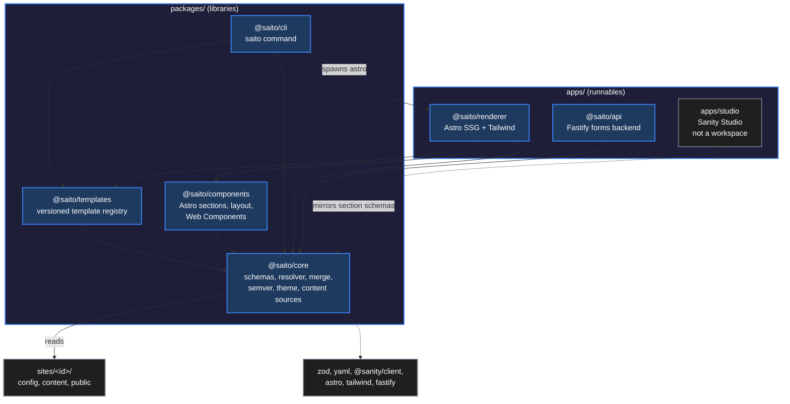

| Component | Responsibility |
|---|---|
| `packages/core` | zod schemas, template → site resolver, deep merge, semver ranges, theme → CSS, content sources (local, Sanity) |
| `packages/templates` | Template marketplace: `landing` (v1, v2), `corporate`, `restaurant`, `event` |
| `packages/components` | One Astro component per section type, site layout, `<saito-contact-form>`, `<saito-countdown>` |
| `packages/cli` | `saito` commands: sites, templates, create, validate, build, dev, outdated, upgrade, affected, seed |
| `apps/renderer` | One Astro project that renders whichever site `SAITO_SITE` selects |
| `apps/api` | Tenant-aware contact form handling |
| `apps/studio` | Sanity Studio schemas for editors (`cd apps/studio && npm install`) |

### Folder structure

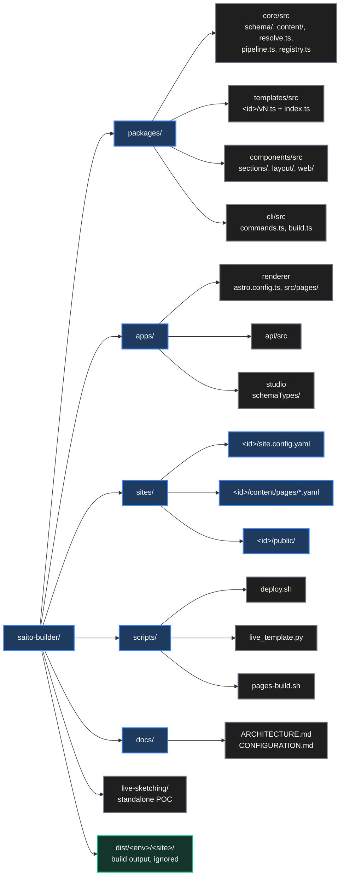

### Resolution pipeline (the core idea)

`loadResolvedSite()` in `packages/core/src/pipeline.ts` turns three layers into the one `ResolvedSite` everything renders from. Precedence: **template < site config < content overlay**.

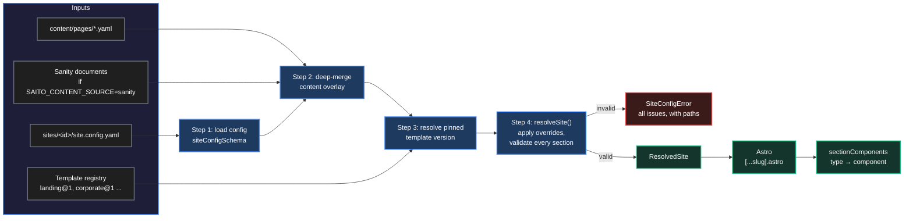

### Override semantics

Overrides are keyed by **section id**, never by array position. Merge rules: objects merge, arrays replace, `null` deletes.

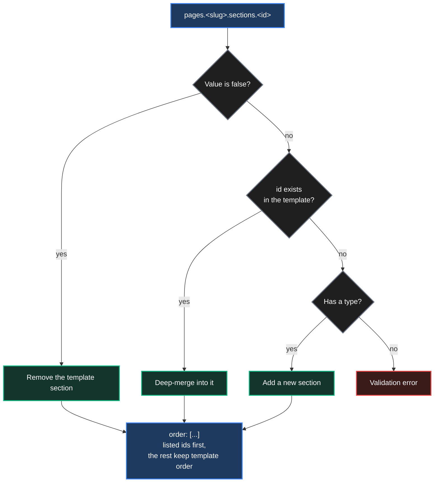

Pages absent from the template need a `title` and typed sections. Sanity documents are converted into this same shape (`sanityToOverlay`), so every content source composes identically.

### Key abstractions

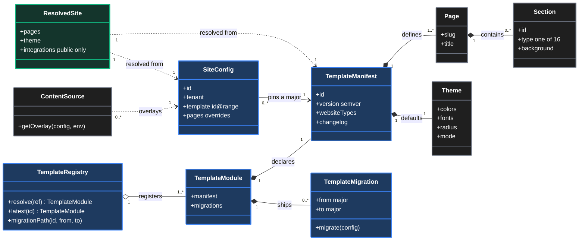

### Configuration and dependency relationships

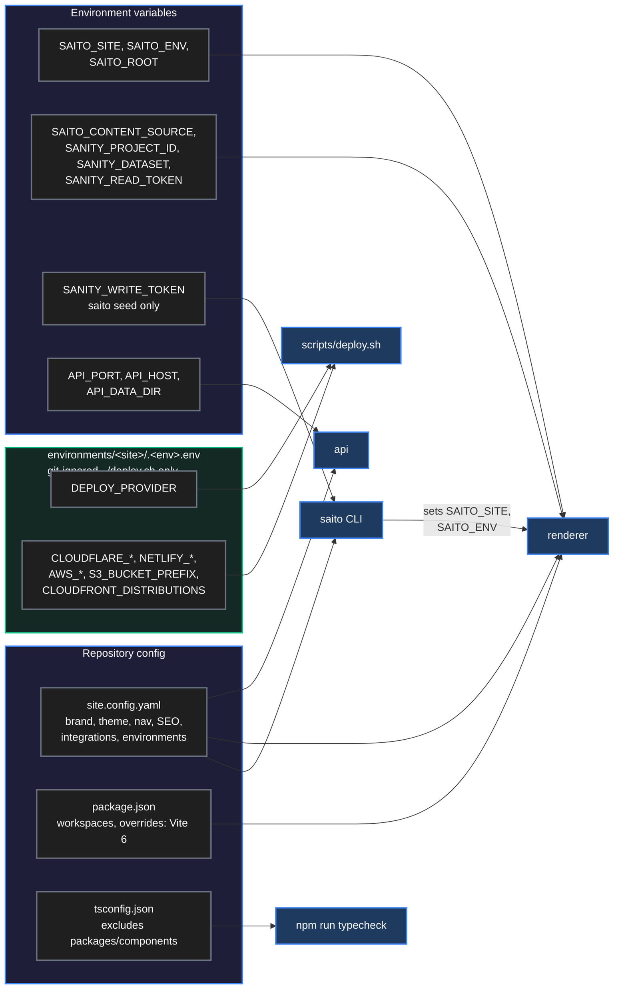

`.env` is never loaded automatically: export the variables, or run `npx tsx --env-file=.env packages/cli/src/index.ts <command>`. `./deploy.sh` loads `environments/<site>/.<local|staging|prod>.env` per site; Cloudflare Pages hook builds take theirs from the project settings ([setup](#cloudflare-pages-setup-per-site)). Field-by-field reference: [docs/CONFIGURATION.md](docs/CONFIGURATION.md).

---

## 3. Workflows

### Developer journey

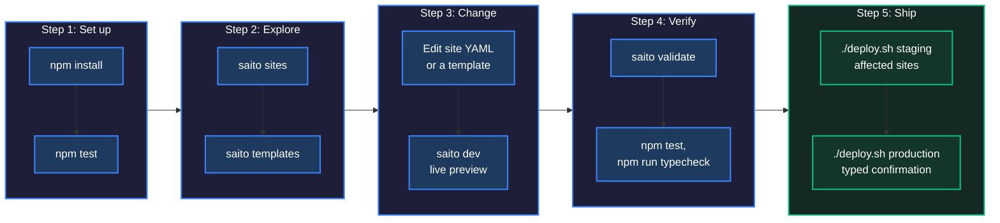

### Creating a new website from a template

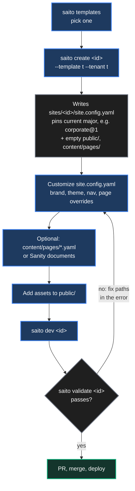

Rules: the site `id` must equal its directory name; ids, tenants and section ids are kebab-case.

### Adding a new template

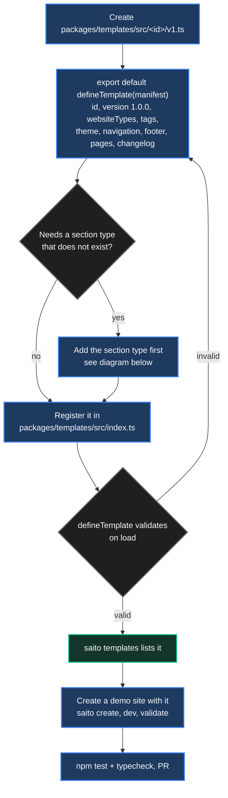

### Adding a section type

Every section type touches four places. The component map is typed `Record<SectionType, …>`, so a missing component is a compile error.

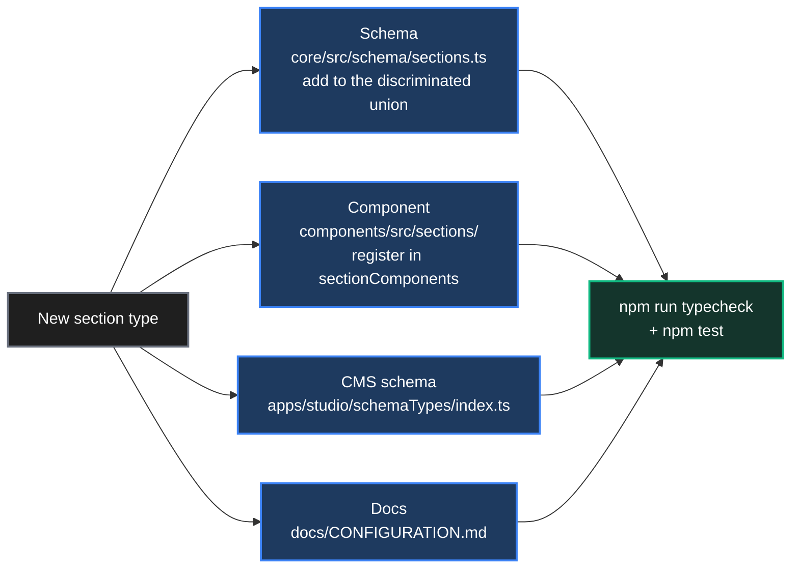

### Modifying a template

Sites pin a **major** (`landing@1`). Non-breaking changes reach every pinned site on its next build; breaking changes ship as a new major with a migration.

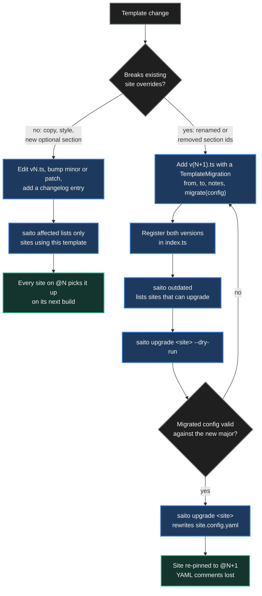

### Content publishing (Sanity)

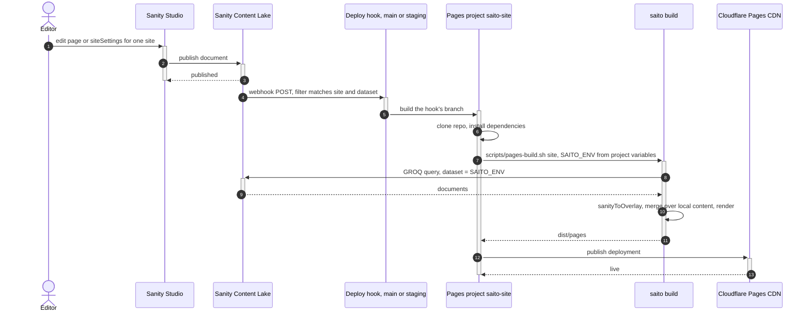

`saito seed` runs the opposite direction (local content → Sanity) and must stay the exact inverse of `sanityToOverlay`; `packages/core/test/seed.test.ts` round-trips every site to enforce it. Builds read Sanity only when `SAITO_CONTENT_SOURCE` is `sanity`: set in the Pages project variables for hook builds, and in `environments/<site>/.<env>.env` for `./deploy.sh`. Setup: [Cloudflare Pages setup (per site)](#cloudflare-pages-setup-per-site).

A publish still runs Astro: pages are static HTML with the content rendered into them, so new content means new HTML. One deploy hook belongs to one Pages project, which builds one site, so only that site is re-rendered and the others are untouched. Patching `dist` without Astro would mean maintaining a second renderer.

> [!IMPORTANT]
> **Golden rule: every field has exactly one owner.** Builds only *read* Sanity and never write to it; a YAML edit never reaches Sanity, and where both define a field, Sanity wins. Never make builds run `saito seed --overwrite`: it would wipe editors' work, revert each publish on the next build, loop through the publish webhook, and put a Sanity write token in the build environment.
>
> 1. **YAML only:** set `SAITO_CONTENT_SOURCE=local` and don't use Sanity, if editors don't need it.
> 2. **Split ownership (the current model):** Sanity owns content; YAML owns structure, theme and integrations. Seed once, then edit content only in the Studio.
> 3. **Optional safety net:** a check that only *warns* when YAML and Sanity disagree. It reports the drift and never writes. (Not implemented yet.)

---

## 4. Build and deployment

### What `saito build` does

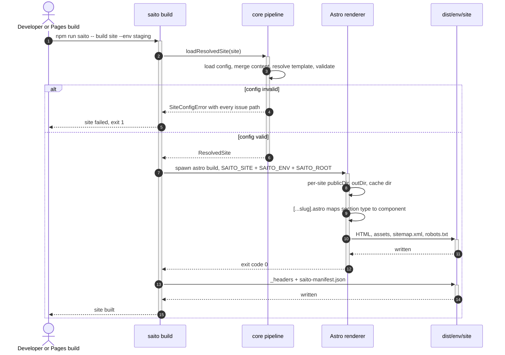

| Artifact | Purpose |
|---|---|
| `_headers` | Immutable caching for `/_astro/*`, short edge TTL + `stale-while-revalidate` for HTML, security headers, `X-Robots-Tag: noindex` outside production |
| `saito-manifest.json` | Site, tenant, environment, URL, template version, pages, build time |

### Checks before a deploy

There is no CI: run the checks by hand, then redeploy the sites the change touches.

```bash
npm test && npm run typecheck && npm run saito -- validate --all
git diff --name-only main | npm run saito -- affected                          # sites this change touches
./deploy.sh staging $(git diff --name-only main | npm run -s saito -- affected)   # redeploy them to staging
```

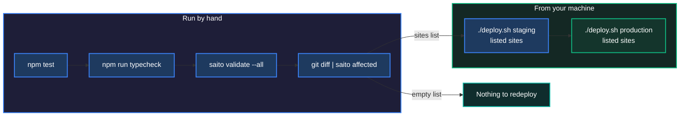

### Which sites a change touches (`saito affected`)

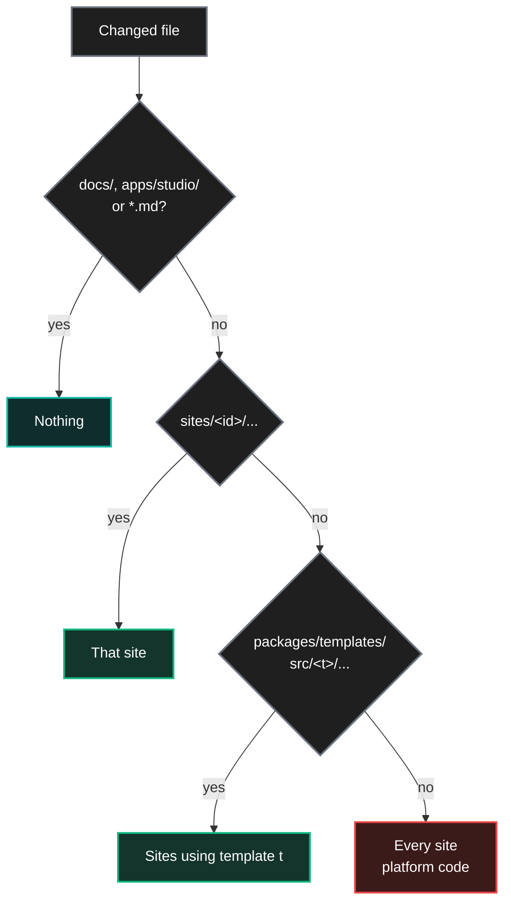

Use it to choose what to redeploy. Keep these path rules in sync with `packages/cli/src/commands.ts` if directories move. Anything else counts as platform code, including `scripts/` and `live-sketching/` HTML.

### Deployment flow

Two paths reach the CDN: `./deploy.sh` from a machine for code and YAML changes, and a Cloudflare Pages deploy hook for Sanity publishes. GitHub runs nothing.

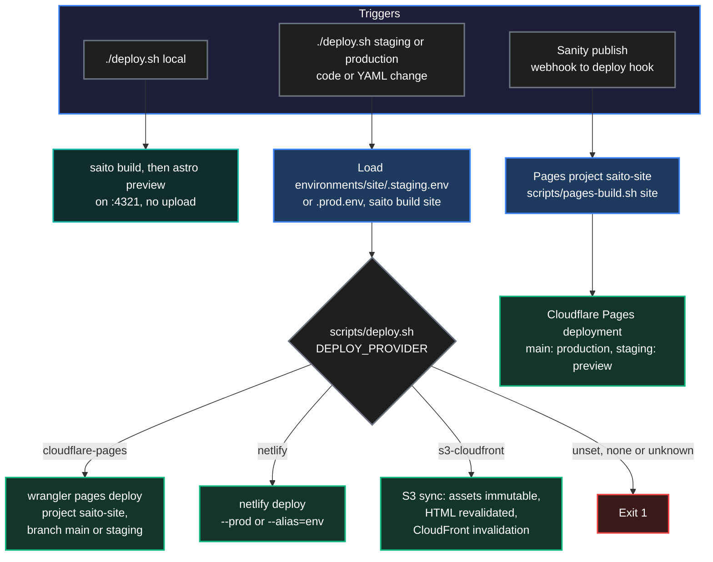

`./deploy.sh <local|staging|production> <site...|--all> [--yes]` builds each site with the CLI into `dist/<env>/<site>/`, then uploads it. `production` asks you to type `production` (or pass `--yes`). Wrangler Direct Upload also works against the Git-connected Pages projects below.

### Cloudflare Pages setup (per site)

Each site has one Pages project, `saito-<site>`, **connected to the GitHub repo**: deploy hooks exist only with Git integration, and a Direct Upload project cannot be converted. Delete and recreate a Direct Upload project (such as the existing `saito-acme-corp`) as Git-connected.

1. **Build settings:** build command `./scripts/pages-build.sh <site>`, output directory `dist/pages`, root directory `/`. The script requires `SAITO_ENV`, runs the normal CLI build for that site and copies `dist/$SAITO_ENV/<site>` to `dist/pages`.
2. **Variables:** Production `SAITO_ENV=production`; Preview `SAITO_ENV=staging`; both `SAITO_CONTENT_SOURCE=sanity`, `SANITY_PROJECT_ID=<project-id>`, `NODE_VERSION=22`. No tokens: the datasets are public and `SANITY_DATASET` defaults to the environment name. Add `SANITY_READ_TOKEN` as a secret only if a dataset becomes private.
3. **Automatic deployments off:** Settings → Builds → Branch control: uncheck automatic production deployments and set preview branches to None, so pushes to GitHub deploy nothing.
4. **Two deploy hooks:** one on branch `main` (production), one on branch `staging` (preview, served at `staging.saito-<site>.pages.dev`). The `staging` git branch must exist. Hook builds use the code on that branch, so run `git push origin main:staging` when staging content builds should pick up new code.
5. **Sanity webhooks** (sanity.io/manage → API → Webhooks), one per site and dataset: URL = the matching deploy hook (`staging` dataset → `staging` hook, `production` dataset → `main` hook), Dataset `staging` or `production`, trigger on create, update and delete, filter `_type in ["page","siteSettings"] && site == "<site-id>"`, HTTP method POST, no projection, drafts off.

> [!WARNING]
> A deploy hook URL is a secret: anyone who has it can trigger builds. Keep it only in Cloudflare and in the Sanity webhook, never in git.

### Build and deployment lifecycle

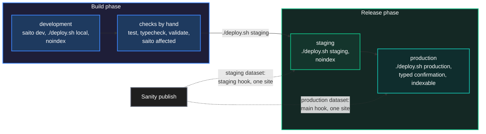

Each environment has its own URL (`environments` in the site config) and its own Sanity dataset. Non-production builds are always `noindex`: meta robots, `robots.txt` and the `X-Robots-Tag` header.

### Site lifecycle

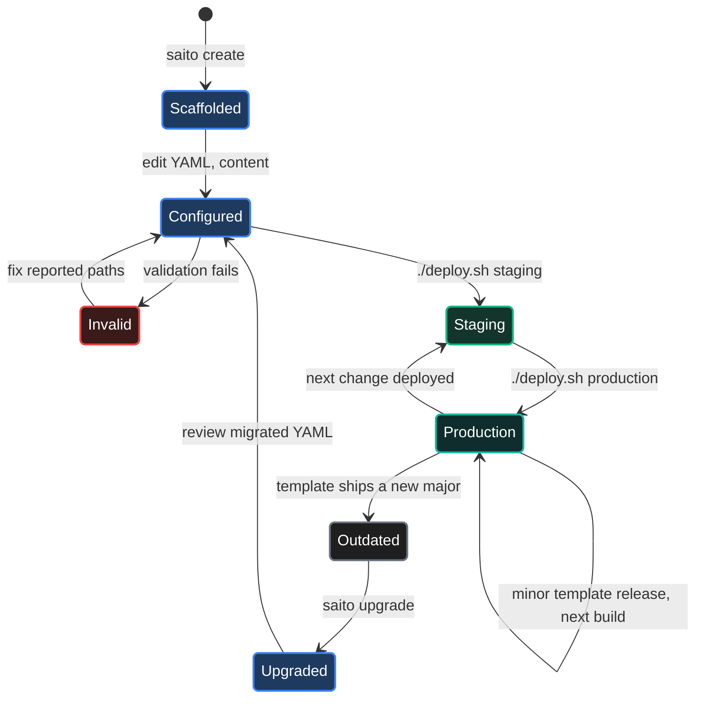

### Prototype previews on GitHub Pages (separate tool)

[`live-sketching/`](live-sketching/README.md) is a standalone proof-of-concept workspace for single-file HTML prototypes. It has no code link to the platform; its only shared piece is the publish script.

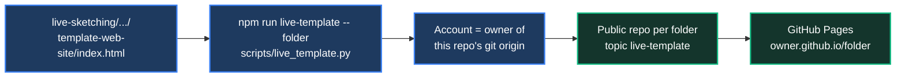

Full workflow, diagrams and caveats: [live-sketching/README.md](live-sketching/README.md).

---

## 5. Operations

### Example sites

| Site | Tenant | Template | Shows |
|------|--------|----------|-------|
| `acme-corp` | acme | corporate@1 | Theme overrides, removed section, extra page, content in separate files, contact form |
| `acme-launch` | acme | landing@1 | Dark theme; pinned to an old major to demo `outdated` / `upgrade` |
| `bella-trattoria` | bella | restaurant@1 | Added gallery section, re-ordered sections, Snipcart online ordering |
| `devconf-2027` | devconf | event@1 | Countdown Web Component, schedule, external ticket links |

### Contact form request

```mermaid
sequenceDiagram
  autonumber
  actor Vis as Visitor
  participant Page as Static page
  participant API as apps/api
  participant Sink as SubmissionSink
  participant Hook as Site webhook

  Vis->>+Page: submit contact form
  Page->>+API: POST /v1/sites/siteId/contact
  alt unknown site or origin not allowed
    API-->>Page: 404 or 403
  else body invalid or over 32 KB, or rate limit hit
    API-->>Page: 400, 413 or 429
  else accepted
    opt honeypot company_website is empty
      API->>+Sink: save to data/tenant/site.jsonl
      Sink-->>-API: saved
      API-)Hook: forward, if forms.webhookUrl is set
    end
    API-->>-Page: 303 redirect to the site's own domain, or 202 JSON
  end
  Page-->>-Vis: thank-you state
```

Only sites with `integrations.forms` are served. Bots that fill the honeypot get a fake success.

### Security boundaries

| Boundary | Rule |
|---|---|
| Rendered data | Render `ResolvedSite`, never raw `SiteConfig`: `integrations` drops server-only `forms.webhookUrl` and `notifyEmail` |
| Links | Every user link goes through `safeHref` (blocks `javascript:` and similar) |
| Rich text | `renderRichText` escapes first, then applies its small markup subset |
| Inline JSON | JSON-LD and analytics snippets use `jsonForScript` |
| CSS | Theme colours are hex only; font names are regex-restricted |
| Indexing | Non-production builds are always `noindex` |
| Secrets | Never in site configs or git: deploy credentials live in git-ignored `environments/<site>/.<env>.env`; deploy hook URLs live only in Cloudflare and the Sanity webhook |
| Sanity ids | Must not contain `.` (dotted ids are private) |

### Gotchas

| Topic | Note |
|---|---|
| Studio | `apps/studio` is deliberately not an npm workspace: `cd apps/studio && npm install` |
| Version pins | Root `overrides` pins Vite 6 so Astro 5 and Vitest share one Vite. Stay on Astro 5, Vitest 3, Zod 3, TypeScript 5 |
| Type checking | `packages/components` is checked by `astro check` through the renderer, not by the root `tsconfig.json` |
| No compile step | Package `exports` point at `src/*.ts`; TypeScript runs through `tsx` and Vite |
| Builds | Always build through the CLI: it resolves first (clear errors), then runs Astro, then writes edge artifacts |
| Linting | No linter is configured |

### Documentation

- [docs/ARCHITECTURE.md](docs/ARCHITECTURE.md): how the platform answers each architecture question in STORY.md
- [docs/CONFIGURATION.md](docs/CONFIGURATION.md): site configuration reference
- [live-sketching/README.md](live-sketching/README.md): prototype workspace and GitHub Pages publishing
