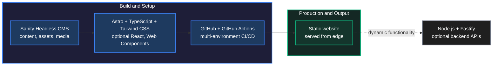
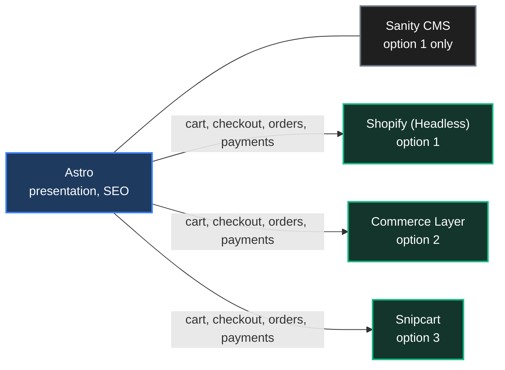
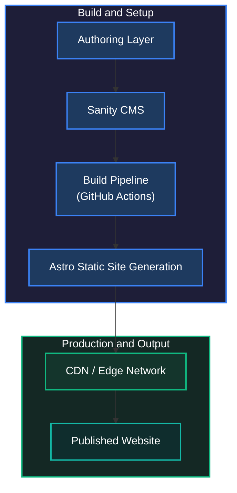

# Solution: Saito Builder

**Type:** Configuration-Driven Multi-Tenant Website Builder

## Contents

- [Brief Description](#brief-description)
- [Nature](#nature)
- [Core Principles](#core-principles)
- [Technology Stack](#technology-stack)
- [Architecture Questions](#architecture-questions)
- [Website Types](#website-types)
- [E-Commerce and Ordering (Conditional)](#e-commerce-and-ordering-conditional)
- [Content Delivery Strategy](#content-delivery-strategy)
- [Saito Builder Architecture](#saito-builder-architecture)
- [Vision Statement](#vision-statement)

---

## Brief Description

Saito Builder is a configuration-driven, multi-tenant platform designed to generate landing pages, homepages, corporate websites, and marketing-focused web experiences using reusable templates, components, themes, and structured configuration data. Rather than building each website from scratch, the platform operates as a "website factory," enabling rapid creation, customization, deployment, and maintenance of multiple websites from a shared architecture and component ecosystem.

The platform is primarily focused on content-driven and marketing-oriented websites. While optimized for static website generation, it supports integration with backend APIs and external services when dynamic functionality is required.

## Nature

- Marketing and content-focused platform.
- Optimized for static website generation.
- Supports backend integrations when needed.
- Designed for rapid website creation and deployment at scale.
- Multi-tenant architecture supporting multiple customers and websites from a shared platform.

## Core Principles

- Configuration-driven architecture
- Multi-tenant platform design
- Reusable templates and layouts
- Component-based development
- Marketplace for layouts and templates
- Content-first approach
- Centralized content management
- Scalable CI/CD pipelines
- Extensible through backend APIs and services

---

## Technology Stack

| Layer | Technologies |
|-------|--------------|
| **Frontend** | TypeScript, Astro, Tailwind CSS, optional React components, Web Components for framework-independent reuse |
| **Content Management** | Sanity Headless CMS: centralized management of content, assets, media, and resources |
| **Backend (Optional)** | Node.js, Fastify |
| **DevOps & Hosting** | GitHub, GitHub Actions, multi-environment CI/CD pipelines, automated deployment workflows, cloud-hosting agnostic architecture |

---

## Architecture Questions

### Site Development Lifecycle

- How is a new website created from an existing template?
- What is the process for configuring and publishing a new website?
- How are site-specific settings managed?

### Template Lifecycle

- How are templates created?
- How are templates versioned and maintained?
- How are template updates propagated to existing websites?
- How can customizations be preserved when a template is upgraded?

### Template-to-Site Transformation

- How is a generic template transformed into a customer-specific website?
- What configuration options are available?
- What customizations can be performed without custom development?

### Scope and Boundaries

- What types of websites can be generated by the platform?
- What functionality is considered in scope?
- What functionality is considered out of scope?
- What level of customization is supported through configuration alone?

### Content Management

- Where is content stored?
- How is content edited and published?
- How are media assets managed?
- How are content changes synchronized across environments?

### Customer Customization

- What content changes can customers perform themselves?
- What layout modifications are supported through configuration?
- When does a change require template modification or custom development?

---

## Website Types

### Candidate Website Types

- Landing Pages
- Homepages
- Corporate Websites
- Marketing Websites
- Product Showcase Websites
- Service Business Websites
- Restaurant Websites
- Real Estate Promotional Websites
- Portfolio Websites
- Event Websites
- Microsites
- Blogs
- News Portals
- Documentation Websites
- Knowledge Bases
- Campaign Websites
- Brand Websites

### Non-Candidate Website Types

- ERP Systems
- CRM Systems
- SaaS Platforms
- Internal Business Applications
- Administrative Dashboards
- Financial Platforms
- Marketplace Platforms
- Social Networks
- Chat Applications
- Workflow Management Systems
- Project Management Platforms
- Learning Management Systems (LMS)
- Real-Time Collaboration Platforms
- Data-Intensive Enterprise Applications

### Conditional Candidate Types

- E-Commerce Online Stores
- Restaurant Ordering

See [CANDIDATES.md](CANDIDATES.md) for the full evaluation.

---

## E-Commerce and Ordering (Conditional)

### Suitable When

- Product catalog is relatively simple
- Focus is on product presentation and marketing
- SEO is a primary requirement
- Shopping cart and checkout are delegated to a specialized e-commerce platform
- Product inventory, orders, and payments are managed externally

### Recommended Architecture

Choose one of the following stacks:

| Option | Frontend | Content | Commerce |
|:------:|----------|---------|----------|
| 1 | Astro | Sanity CMS | Shopify (Headless) |
| 2 | Astro | n/a | Commerce Layer |
| 3 | Astro | n/a | Snipcart |

### Examples

- Restaurant online ordering
- Boutique stores
- Small and medium business catalogs
- Product showcase websites with checkout integration
- Brand-focused direct-to-consumer websites

### Not Suitable When

- Complex inventory management is required
- Multi-vendor marketplace functionality is needed
- Advanced promotions and pricing rules exist
- Extensive customer account management is required
- ERP-level integrations are necessary
- The platform becomes application-centric instead of content-centric

### Non-Candidate Scenarios

- Amazon-like marketplaces
- Multi-vendor platforms
- Enterprise B2B commerce
- Large-scale omnichannel commerce solutions
- Highly customized shopping experiences requiring significant business logic

---

## Content Delivery Strategy

**Suitability:** Core Platform Capability

All generated websites should be optimized for edge delivery through a CDN, enabling low-latency global content distribution, high availability, improved SEO, and reduced infrastructure costs.

### Benefits

- Faster page load times
- Improved Core Web Vitals
- Better SEO performance
- Lower origin server load
- Global scalability
- Improved resilience and availability

### Recommended CDN Providers

- Cloudflare
- CloudFront (AWS)
- Azure CDN
- Fastly
- Vercel Edge Network
- Netlify Edge

---

## Saito Builder Architecture

---

## Vision Statement

> Saito Builder is a website factory platform that enables organizations to create, manage, and deploy high-performance marketing and content-driven websites at scale using reusable templates, configurable layouts, centralized content management, and automated deployment pipelines. The platform prioritizes speed, consistency, maintainability, and operational efficiency while minimizing the need for custom development for each individual website.
