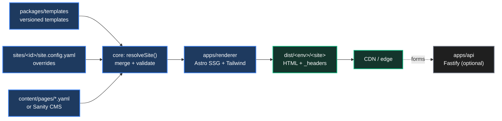

# Saito Builder architecture

This document answers the architecture questions in [STORY.md](../STORY.md) for the implementation in this repository.



## Core model: three layers, one merge

A site's final configuration is computed at build time from three layers. Each layer deep-merges over the one before it:

1. **Template defaults** (`packages/templates/src/<id>/vN.ts`): pages, sections, theme, navigation and footer.
2. **Site config** (`sites/<id>/site.config.yaml`): settings and overrides chosen by the site owner.
3. **Content overlay** (`sites/<id>/content/pages/*.yaml`, then Sanity when `SAITO_CONTENT_SOURCE=sanity`): editorial copy.

Overrides are keyed by **section id**, never by array position:

```yaml
pages:
  index:
    sections:
      hero: { heading: "New heading" }           # merge into the template's "hero"
      testimonials: false                        # remove it
      gallery: { type: gallery, images: [...] }  # new id + type → add a section
    order: [hero, gallery]                       # optional re-ordering
```

`resolveSite()` (`packages/core/src/resolve.ts`) applies the overrides and then validates every section against its zod schema. It reports *all* problems at once, each with a path such as `pages.index.sections.hero.heading`. A site that fails validation never reaches Astro.

## Site development lifecycle

**How is a new website created from an existing template?**
`saito create <id> --template <t> --tenant <tenant>` writes `sites/<id>/site.config.yaml`, which pins the template's current major (`corporate@1`), plus empty `public/` and `content/pages/` folders. The generated file is validated before it is written.

**What is the process for configuring and publishing a new website?**
1. Edit `site.config.yaml` (brand, theme, environments, integrations, page overrides).
2. `saito dev <id>` gives a live preview; `saito validate <id>` checks the config.
3. Run the checks by hand (`npm test`, `npm run typecheck`, `saito validate --all`); there is no CI. `git diff --name-only main | saito affected` lists the sites the change touches.
4. `./deploy.sh staging <site...>` builds and uploads them to **staging** from your machine.
5. `./deploy.sh production <site...>` promotes to **production** after a typed confirmation.

**How are site-specific settings managed?**
In `site.config.yaml`, validated by `siteConfigSchema` (`packages/core/src/schema/site.ts`). Per-environment values (URLs) live under `environments`. Secrets never go in site configs: deploy credentials live in git-ignored `environments/<site>/.<local|staging|prod>.env` files. Server-only values such as `forms.webhookUrl` are stripped from the resolved site, so they cannot leak into HTML.

## Template lifecycle

**How are templates created?**
A template is a TypeScript module that calls `defineTemplate({...})`. It declares metadata (name, website types, tags), a theme, navigation, a footer, and pages built from the shared section library. `defineTemplate` validates the template when it loads. Register it in `packages/templates/src/index.ts`.

**How are templates versioned and maintained?**
With semantic versioning. Several majors can coexist in the registry (`landing/v1.ts` and `landing/v2.ts`), so sites upgrade on their own schedule. Each version carries a `changelog`.

**How are template updates propagated to existing websites?**
Sites pin a **major** version (`landing@1`). Minor and patch releases (copy tweaks, new optional sections, style fixes) reach every site on its next build. `saito affected` maps a change in `packages/templates/src/<id>/` to exactly the sites that use that template, so only those need redeploying. Major releases are opt-in: `saito outdated` lists the sites that can upgrade.

**How can customisations be preserved when a template is upgraded?**
- Sites store only *overrides*, never a copy of the template. A new template version therefore keeps every customisation that still applies.
- A breaking release ships a `TemplateMigration` that rewrites the site's overrides. For example, landing v2 renames the `signup` section to `get-started` and rewrites `#signup` links.
- `saito upgrade <site>` runs the migration chain. It validates the result against the new template before writing anything; `--dry-run` previews the change.

## Template-to-site transformation

**How is a generic template transformed into a customer-specific website?**
`loadResolvedSite()` loads the site config, layers in content, resolves the pinned template from the registry, and calls `resolveSite()`. The resulting `ResolvedSite` is what the Astro renderer consumes: one `[...slug].astro` route renders every page by mapping each section `type` to its component.

**What configuration options are available?**
See [CONFIGURATION.md](CONFIGURATION.md). In short:
- Brand: logo and favicon.
- Theme tokens: nine colours, two fonts, radius, light/dark mode.
- Navigation and footer.
- SEO: title template, share image, schema.org type, noindex.
- Integrations: analytics, commerce, forms.
- Per-environment URLs.
- Page overrides: edit, remove, add or reorder sections; add or disable pages.

**What customisations can be performed without custom development?**
Everything listed above, plus any combination of the 16 section types: hero, features, stats, logoCloud, testimonials, pricing, faq, cta, richText, gallery, team, menu, products, contact, schedule, countdown. Each has layout variants and four background tones.

## Scope and boundaries

| | |
|---|---|
| **In scope** | Content- and marketing-driven static sites: landing pages, corporate, campaign, restaurant, event, portfolio, microsites. Contact forms through the optional API. Light commerce delegated to Snipcart, Shopify or Commerce Layer. |
| **Out of scope** | ERP, CRM, SaaS products, dashboards, marketplaces, user accounts, real-time features (see the "Non-Candidate" types in STORY.md). |
| **Configuration only** | Anything expressible as section data and theme tokens. |
| **Needs development** | A new section type: core schema, component and Studio schema. A new template, a new integration, or bespoke page layouts. |

The schema enforces this boundary: an unknown section type or field fails validation, so one-off hacks cannot creep into a site config.

## Content management

**Where is content stored?**
- In git: site configs and `content/pages/*.yaml`, versioned and reviewed through PRs.
- In Sanity: datasets `development`, `staging` and `production`, with `page` and `siteSettings` documents scoped by `site` id. Media lives in Sanity's asset CDN.

**How is content edited and published?**
Developers and power users edit YAML. Editors use the Sanity Studio (`apps/studio`), which mirrors the core section schemas. Each CMS section carries a `sectionId`: one that matches a template section overrides it, and a new id adds a section. On publish, a Sanity webhook calls the site's Cloudflare Pages deploy hook (one per site and dataset), and the Git-connected Pages project `saito-<site>` rebuilds just that site with `scripts/pages-build.sh`. The build still runs Astro because content is rendered into static HTML; one hook re-renders one site and leaves the others untouched.

**How are media assets managed?**
Site-specific static assets go in `sites/<id>/public/`, which Astro uses as that site's `publicDir`. CMS images go through Sanity's image CDN; `content/sanity.ts` turns image references into CDN URLs.

**How are content changes synchronised across environments?**
Each environment builds from its own dataset (`SANITY_DATASET` defaults to the environment name). Promote content with `sanity dataset copy staging production` or by re-publishing; git content moves through the normal branch and deploy flow. Non-production builds are always `noindex` (meta robots, `robots.txt` and an `X-Robots-Tag` header).

## Customer customisation

**What content changes can customers perform themselves?**
In Sanity: all section copy, images, lists (features, plans, FAQs, menu items, schedule), navigation, footer and SEO text. They can also add, remove or reorder sections, and add pages built from existing section types.

**What layout modifications are supported through configuration?**
Section order, section variants (hero `centered`/`split`/`image-background`, column counts, narrow or wide text), background tones per section, and theme tokens (colours, fonts, corner radius, dark mode).

**When does a change require template modification or custom development?**
- A section type that does not exist yet.
- A structural layout change the variants cannot express.
- A new third-party integration.
- Behaviour beyond static content and form posts, such as accounts, search or dynamic data.

## Multi-tenancy

- Every site declares a `tenant`. The CLI filters by it (`saito build --tenant acme`, `saito sites --tenant acme`), and the Studio groups content by site.
- Builds are isolated per site: separate output directory, publicDir, Astro cache and CDN project.
- The API stores submissions in `data/<tenant>/<site>.jsonl`. It accepts a site's submissions only from that site's own origins, and redirects only to that site's domain.

## Content delivery

`saito build` writes, next to the HTML:
- `_headers`: immutable caching for fingerprinted `/_astro/*` assets; short edge TTL with `stale-while-revalidate` for HTML; security headers. Cloudflare Pages and Netlify read it natively.
- `saito-manifest.json`: site, tenant, environment, template version and page list, for deploy tooling and audits.

`scripts/deploy.sh`, called by `./deploy.sh`, keeps manual deploys pluggable (`DEPLOY_PROVIDER` = `cloudflare-pages` | `netlify` | `s3-cloudfront`), so no part of the platform depends on a single cloud. Content publishes rebuild through Cloudflare Pages deploy hooks.

## Security notes

- All config and CMS input is schema-validated. Theme values are restricted (hex colours, alphanumeric font names) before being written into CSS.
- Links pass through `safeHref`, which blocks `javascript:` and similar schemes. Rich text is escaped before its small markup subset is applied. JSON-LD and analytics snippets use `jsonForScript`.
- API protections: per-site origin allow-list, rate limiting (10 per minute per IP), 32 KB body limit, honeypot field, and redirects limited to the site's own domain.
