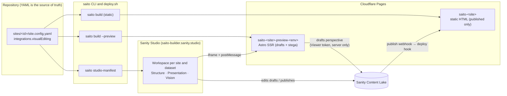

# Sanity live visual editing: implementation guidelines

> **Status:** proposal, not implemented. **Date:** 2026-10-29.
> **Applies to:** `apps/studio`, `apps/renderer`, `packages/core`, `packages/cli`, `deploy.sh`.

## 1. Goal

Editors should find a page the way the website is organised. They should also be able to edit content by clicking it on a live preview of the site. Every site gets this the same way: a site opts in with one YAML block, and the CLI, Studio and `deploy.sh` derive everything else. No site needs its own code.

The work comes in four steps:

| Step | What editors get | New infrastructure |
|---|---|---|
| 1. Navigation-shaped Studio | Pages listed and nested like the site's menu | None (Studio config) |
| 2. Readable documents | Section outlines with thumbnails, clear labels, grouped fields | None (Studio schema) |
| 3. One workspace per site | Each site has its own Studio area | None (generated Studio config) |
| 4. Live visual editing | The site appears in the Studio; click any text or image to edit it | A preview server for each site and environment |

Steps 1–3 only change Studio configuration. Step 4 adds the preview server.

**Out of scope**
- Editing YAML-owned fields from the Studio (see the golden rule below).
- Changing the static publish flow: Sanity webhook → Cloudflare deploy hook → `scripts/pages-build.sh`.

## 2. Principles

1. **The golden rule does not change** ([README, "Content publishing"](../README.md)). Sanity owns content; YAML owns structure, theme and integrations. The preview shows YAML values, but only Sanity-owned values can be clicked and edited. No code path writes to Sanity.
2. **Public sites stay static.** Live editing runs on a separate preview deployment. Public builds never contain draft content, stega markers or the visual-editing script, and the build fails if they do (§8.5).
3. **One source of truth.** `sites/<id>/site.config.yaml` drives the Studio, through a generated manifest, and the preview server, through a bundled config. Static and preview rendering share one resolve function, so they cannot drift apart.
4. **Secure by default.** Without a validated preview session, the preview server serves published content with no editing overlays.

## 3. Architecture



**Editing a page**
1. The editor opens `Acme Corporation · Staging` → **Presentation**.
2. The Studio loads the preview server in an iframe and calls `/api/preview/enable` with a one-time secret.
3. The preview server checks that secret with Sanity and sets a short-lived preview session cookie.
4. Each request then renders through the same pipeline as a static build. The difference is the content overlay: Sanity drafts, fetched with stega encoding.
5. The editor clicks a heading, and the Studio opens that field.
6. When the editor types, the draft changes, the overlay script reloads the page, and the server re-renders it with the latest draft.
7. **Publish** works as it does today: the webhook calls the deploy hook and the static site rebuilds. The preview server needs no redeploy for content changes.

## 4. YAML configuration (the only per-site input)

Add an optional `integrations.visualEditing` block and an optional `previewUrl` per environment:

```yaml
# sites/acme-corp/site.config.yaml
environments:
  staging:
    url: https://staging.saito-acme-corp.pages.dev
    # Optional. Derived by convention when omitted: https://saito-<site>-preview-<env>.pages.dev
    previewUrl: https://saito-acme-corp-preview-staging.pages.dev
  production:
    url: https://www.acme.example

integrations:
  visualEditing:
    enabled: true
    # Datasets that get a preview server and a Presentation tool. Default: [staging]
    environments: [staging]
```

**Schema changes** in `packages/core/src/schema/site.ts`:
- `integrationsSchema.visualEditing`: `z.object({ enabled: z.boolean().default(false), environments: z.array(z.enum(['staging', 'production'])).default(['staging']) }).optional()`
- environment entry: `z.object({ url: z.string().url(), previewUrl: z.string().url().optional() })`
- Add a refinement: every listed environment must exist in `environments`. `saito validate` then reports a misconfiguration as a normal config issue.
- Add a helper `previewUrl(config, env)` that returns the explicit `previewUrl` or the convention. The CLI, the manifest and `deploy.sh` must all use it.

**Docs to update in the same change:**
- `docs/CONFIGURATION.md`
- `sites/example.config.yaml`: a commented `visualEditing` example.

**Platform-wide values stay in env files, not in site YAML:** Sanity project id, Studio hostname, tokens and secrets (see §9.3).

## 5. Step 1: a Studio laid out like the website

**Today:** [`apps/studio/structure.ts`](../apps/studio/structure.ts) has "Pages by site" → site id → Settings / Pages, where pages are an unordered list. "All pages" and "All site settings" sit at the top level, which is why the Studio feels like a database.

**Requirements**
- Show site names (`name` from YAML, e.g. "Acme Corporation") instead of ids.
- List pages in website order:
  1. Home first.
  2. Then the order of `navigation.links`: from Sanity `siteSettings` if an editor changed it, otherwise from the manifest.
  3. Then any remaining pages, alphabetically.
- Nest child pages under their parent by slug path (e.g. `services/consulting` under Services).
- Each item shows the page title, its URL path as the subtitle, and a page icon.
- Show "All pages" and "All site settings" only in the admin workspace (see Step 3).

**Implementation**
- Write a factory `siteStructure(site: ManifestSite): StructureResolver` that takes the site entry from the generated manifest (§7).
- Build the list with `S.documentListItem().id(sanityDocumentId(site.id, slug))`. Seeded documents have deterministic ids (`saito-<site>-page-<slug>`), so the order can be explicit without extra queries.
- Append a filtered `S.documentList()` for pages that are not in the manifest, i.e. pages created in the Studio.
- Read the navigation order with one GROQ query (`*[_type == "siteSettings" && site == $site][0].navigation.links[].href`), and fall back to the manifest order.

**Acceptance criteria**
- For acme-corp, the list reads Home, Services, About, Careers, Contact, which is the site menu order.
- A page created in the Studio appears under "Other pages" without a redeploy.

## 6. Step 2: readable documents

**Today:**
- A section preview shows `heading` and `sectionId`.
- Technical fields (`sectionId`, `anchor`, `background`, `layout`) sit next to content fields.
- Some fields have no visible label; for example, the hero button link shows only `/contact/`.

**Requirements**
- **Section previews:**
  - Title: `heading`, falling back to `title` and then the section type label.
  - Subtitle: the section type ("Hero", "Gallery").
  - Media: the first image in the section.
  - Icon: one icon per section type.
- **Field groups** on every section:
  - **Content** (default)
  - **Media**
  - **Links**
  - **Layout** (`layout`, `background`, `variant`)
  - **Advanced** (`sectionId`, `anchor`)
- **`sectionId`:** set it automatically when a section is inserted (the type name, deduplicated) and make it read-only afterwards. It is a merge key, and editing it detaches the section from the template.
- **Field help text:** every field has a `title` and a one-line `description`. Link objects read "Button text" / "Button link". Reuse zod `.describe()` texts where they exist, so YAML docs and the Studio say the same thing.
- **Insert menu:** use a thumbnail grid (`options.insertMenu.views: [{ name: 'grid', previewImageUrl: (type) => \`/static/sections/${type}.png\` }]`), with images in `apps/studio/static/sections/`. Generating the thumbnails is optional (§12).
- **"Open page" link:** add a document view or badge that opens the page's staging and production URLs from the manifest. After Step 4, the Presentation tool's "Used on" banner replaces it.

**Implementation:** keep the existing `section()` helper in [`apps/studio/schemaTypes/index.ts`](../apps/studio/schemaTypes/index.ts) as the single place that adds groups, preview and `sectionId` behaviour. That way every section type, including future ones, gets the same treatment.

**Acceptance criteria**
- Opening the acme-corp home page shows an outline: "Hero · Engineering that moves industry" with its image, then "Logo cloud", "Stats", and so on.
- A schema test fails if a section type lacks a preview, groups or field descriptions.

## 7. Step 3: one workspace per site, generated from YAML

**`saito studio-manifest`** (new CLI command) resolves every site and writes `apps/studio/saito-sites.json`.

The file is git-ignored and regenerated by `./deploy.sh studio` and by a `predev` script in `apps/studio`. It is bundled into the public Studio, so it **must not contain secrets**:

```json
{
  "datasets": ["staging", "production"],
  "sites": [
    {
      "id": "acme-corp",
      "name": "Acme Corporation",
      "tenant": "acme",
      "pages": [{ "slug": "index", "path": "/", "title": "Home" }, { "slug": "services", "path": "/services", "title": "Services" }],
      "navigation": ["index", "services", "about", "careers", "contact"],
      "urls": { "staging": "https://staging.saito-acme-corp.pages.dev", "production": "https://www.acme.example" },
      "visualEditing": { "staging": "https://saito-acme-corp-preview-staging.pages.dev" }
    }
  ]
}
```

**Workspaces** (in [`apps/studio/sanity.config.ts`](../apps/studio/sanity.config.ts)):
- For each site and dataset, create a workspace:
  - name `<site>-<dataset>`
  - `basePath` `/<site>/<dataset>`
  - title `Acme Corporation · Staging`
- Add one `admin-<dataset>` workspace per dataset that keeps today's all-sites view.
- In site workspaces:
  - documents are filtered by `site == $site`;
  - new-document templates prefill `site`, and the `site` field is hidden;
  - the Structure tool uses `siteStructure(site)` from Step 1;
  - the Presentation tool is added only for datasets listed in `visualEditing.environments` (Step 4).

**Limits**
- **Workspaces organise the Studio; they do not restrict access.** Any project member can switch workspaces. Restricting a tenant to their own site requires Sanity custom roles (paid plan) or a separate Sanity project per tenant.
- **Workspace count:** there are sites × datasets workspaces (today 5 × 2 = 10). Past about 20, switch to one workspace per dataset with a site picker.

**Acceptance criteria**
- Adding a site directory and running `./deploy.sh studio` creates its workspaces, with no Studio code change.

## 8. Step 4: live visual editing

### 8.1 Studio: the Presentation tool

The Studio already runs Sanity v4, which includes `sanity/presentation`. Generate the tool per site workspace from the manifest:

```ts
presentationTool({
  previewUrl: {
    initial: site.visualEditing[dataset],
    previewMode: { enable: '/api/preview/enable' },
  },
  allowOrigins: [site.visualEditing[dataset]], // exact origin, never a wildcard
  resolve: {
    // Exact routes from the manifest first, then a fallback for pages created in the Studio.
    mainDocuments: defineDocuments([
      ...site.pages.map((p) => ({ route: p.path, filter: `_id == "${sanityDocumentId(site.id, p.slug)}"` })),
      { route: '/:slug', filter: `_type == "page" && site == "${site.id}" && slug.current == $slug` },
    ]),
    locations: {
      page: defineLocations({
        select: { title: 'title', slug: 'slug.current' },
        resolve: (doc) => ({ locations: [{ title: doc?.title ?? doc?.slug, href: doc?.slug === 'index' ? '/' : `/${doc?.slug}` }] }),
      }),
      siteSettings: { message: 'Used on every page (header, footer, SEO)', tone: 'positive' },
    },
  },
});
```

For local development, `SANITY_STUDIO_PREVIEW_ORIGIN=http://localhost:4321` overrides `initial` and `allowOrigins`.

### 8.2 Preview server: the renderer in preview mode

**Mode switch.** `SAITO_MODE=preview` is set by the CLI, never by hand. In [`apps/renderer/astro.config.ts`](../apps/renderer/astro.config.ts) it switches to:
- `output: 'server'`
- `adapter: cloudflare()` (`@astrojs/cloudflare`, the release compatible with Astro 5)
- `outDir: dist/preview/<env>/<site>`

Static mode does not change.

**No file system at request time.** Cloudflare's runtime cannot read `sites/`, so the work splits between build time and request time:
- **Build time:** the CLI resolves the YAML side (site config plus local content files). The result is exposed to the server bundle as a Vite virtual module, `virtual:saito/site-config`.
- **Request time:**
  1. fetch the Sanity draft overlay;
  2. `deepMerge`;
  3. `parseSiteConfig`;
  4. `registry.resolve`;
  5. `resolveSite`.
- **Refactor needed in core:** move `parseSiteConfig` out of `loader.ts` (which imports `node:fs`) into a module with no file-system access.
- **Shared resolver:** export one `resolveFromConfig(config, overlay, { env, registry })` that both `loadResolvedSite` and the preview server call. Static and preview output then cannot diverge.
- **Compatibility flags:** set `nodejs_compat` with a recent `compatibility_date`, so `process.env` is populated on Cloudflare.

**Route.** In preview mode, `src/pages/[...slug].astro` resolves the site per request and renders the matching page, or the 404 page. `robots.txt` returns `Disallow: /`, and the sitemap is disabled.

**Content source.** In preview mode, `contentSourceFromEnv` creates the Sanity client as follows; static builds keep `perspective: 'published'` and no stega:

```ts
createClient({
  projectId, dataset, apiVersion,
  token: env.SANITY_READ_TOKEN,   // Viewer, server-side only
  useCdn: false,
  perspective: session ? 'drafts' : 'published',
  stega: session
    ? { enabled: true, studioUrl: `https://${studioHost}.sanity.studio/${site.id}/${dataset}`, filter: proseOnly }
    : false,
});
```

**Overlays.**
- `SiteLayout` loads `enableVisualEditing()` from `@sanity/visual-editing`, but only in the preview build and only with a valid session. The import must be dynamic and guarded by `import.meta.env.SAITO_PREVIEW`, so static bundles never include it.
- Refresh strategy: reload the page. The server re-renders with the latest draft, so no client-side data loading is needed.
- `react` and `react-dom` are peer dependencies of the overlay library.
- We use `@sanity/visual-editing` directly rather than `@sanity/astro`. The pipeline already has its own Sanity client in core, and `@sanity/astro` would add a second client and the React integration just to render one component.

### 8.3 Stega safety: the main correctness rule

Stega appends invisible characters to strings, and those characters link each string back to its Sanity document and field. Saito validates and compares strings in many places: zod enums, kebab-case regexes, `url()` checks, `variant === 'split'`, section ids used as merge keys, `safeHref`, colours written into CSS, and JSON-LD. **One encoded structural string breaks validation or rendering.**

1. **Encode only prose (allow-list, not deny-list).**
   - Core exports `proseFieldPaths`, generated from the zod section schemas: plain `z.string()` fields with no enum, regex, url or email check (e.g. `heading`, `subheading`, `body`, `quote`, `caption`, `answer`).
   - The stega `filter` returns `true` only for those paths, and also requires `filterDefault` to pass.
   - New section types are covered automatically.
2. **Clean structural values in `sanityToOverlay` anyway.** Apply `stegaClean` to `sectionId`, `slug`, `order`, `enabled`, the type and image references. This is defence in depth in case the filter changes.
3. **Clean at trust boundaries.** `safeHref`, `jsonForScript`, the inputs to `themeToCss`, and any value written into an HTML attribute (`id`, `class`, `data-bg`) call `stegaClean` first. These are no-ops on unencoded strings, so static builds are unaffected.
4. **Images.**
   - URLs cannot carry stega. Add an optional `editRef?: string` to `imageSchema`.
   - In preview mode, `sanityToOverlay` fills it using `createDataAttribute({ id, type, path, baseUrl, workspace })`.
   - Components spread it as `data-sanity` through a shared `imageAttrs(image)` helper. Today all 16 section components render `` inline, so each needs a one-line change to use the helper.
5. **Components don't manipulate prose.** No `slice`, truncation, `toUpperCase` or slugifying of content strings without cleaning them first. Those operations corrupt or strip the markers.

### 8.4 Security controls

| Risk | Control |
|---|---|
| Draft content leaking to the public | The preview server serves **published** content with no overlays unless a valid session exists. Only `/api/preview/enable` creates a session, after validating the Studio's one-time secret with `validatePreviewUrl` (`@sanity/preview-url-secret`). |
| Forged preview session | The cookie value is an HMAC-signed expiry (Web Crypto, `SAITO_PREVIEW_SESSION_SECRET`), set as `HttpOnly; Secure; SameSite=None; Partitioned; Max-Age=3600`. Because it is partitioned, it only works inside the Studio iframe; opening the preview URL directly shows published content. |
| Read token exposure | `SANITY_READ_TOKEN` (Viewer role) is a Cloudflare secret, used only in server code, and never appears in client bundles, HTML or the Studio manifest. |
| Framing / clickjacking | Preview responses send `Content-Security-Policy: frame-ancestors https://<studio-host>.sanity.studio` (plus `http://localhost:3333` in dev) and **omit** `X-Frame-Options: SAMEORIGIN`, which would block the Presentation iframe. Static `_headers` don't change. |
| Indexing and caching drafts | `X-Robots-Tag: noindex, nofollow`, `robots.txt` set to `Disallow: /`, and `Cache-Control: private, no-store` on every preview response. |
| postMessage from other origins | `allowOrigins` is the exact preview origin, with no wildcard. |
| Writes to Sanity | None. A Viewer token cannot write, which matches the golden rule. |

### 8.5 Static-build guards

- `saito build` (static) asserts `perspective: 'published'` and stega off.
- It **fails** if any output file contains stega characters (`U+200B`, `U+200C`, `U+200D`, `U+FEFF` sequences) or the string `@sanity/visual-editing`.
- This guard runs in `./deploy.sh` and `scripts/pages-build.sh`, so a misconfiguration can never publish draft content.

## 9. Pipeline integration

### 9.1 CLI

| Command | Behaviour |
|---|---|
| `saito validate` | Also validates `integrations.visualEditing` (environments exist; preview URL is explicit or derived). |
| `saito build <site> --preview [--env staging]` | SSR build to `dist/preview/<env>/<site>/`. Refuses if visual editing is not enabled for that environment. |
| `saito dev <site> --preview` | Astro dev server in server mode on `:4321`, with drafts and stega, for local Presentation testing. |
| `saito studio-manifest [--out <file>]` | Writes the Studio manifest (§7). |
| `saito affected` | Rules unchanged. Preview servers redeploy on the same triggers as static sites (code or YAML), never on content. |

### 9.2 `deploy.sh`

| Target | Behaviour |
|---|---|
| `./deploy.sh preview <site...>\|--all [--env staging\|production]` | For each site with visual editing enabled for that environment: loads `environments/<site>/.<env>.env`, runs `saito build --preview`, creates the Pages project `saito-<site>-preview-<env>` if missing (`wrangler pages project create … --production-branch main`), syncs the secrets (`wrangler pages secret bulk`), and deploys. `--all` skips sites without the flag. |
| `./deploy.sh studio` | Runs `saito studio-manifest`, then `npx sanity deploy` in `apps/studio` (reads `apps/studio/.env`). |
| `./deploy.sh staging\|production …` | Unchanged, plus the static-build guard (§8.5). |

### 9.3 Environment variables (add to `.env.example`)

| Variable | Where | Purpose |
|---|---|---|
| `SANITY_READ_TOKEN` | `environments/<site>/.<env>.env` → preview Pages secret | Viewer token for drafts and preview-secret validation. Already exists. |
| `SAITO_PREVIEW_SESSION_SECRET` | same | New: 32 random bytes that sign preview session cookies. One per preview server. |
| `SANITY_STUDIO_PREVIEW_ORIGIN` | `apps/studio/.env` (dev only) | Points the Presentation tool at `http://localhost:4321`. |
| `SAITO_MODE` | Set by the CLI | `preview` switches the renderer to SSR. Never set it by hand. |

### 9.4 What triggers what

| Event | Static site | Preview server | Studio |
|---|---|---|---|
| Editor types (draft) | Nothing | Shows the change on reload (live) | n/a |
| Editor publishes | Deploy hook rebuild (unchanged) | Already current | n/a |
| YAML or code change | `./deploy.sh staging\|production <site>` | `./deploy.sh preview <site>` | `./deploy.sh studio` if pages, navigation or site names changed |
| New site with `visualEditing.enabled` | Standard setup | `./deploy.sh preview <site>` | `./deploy.sh studio` |

## 10. Onboarding a site (standard checklist)

1. Add `integrations.visualEditing` to `sites/<id>/site.config.yaml`.
2. Add `SANITY_READ_TOKEN` (Viewer) and `SAITO_PREVIEW_SESSION_SECRET` to `environments/<id>/.staging.env`.
3. `npm run saito -- validate --all`
4. `./deploy.sh preview <id>`, then `./deploy.sh studio`.
5. In the Studio, open **\<Site name\> · Staging → Presentation**, click a heading, edit it, and check that the preview updates.

No site-specific code is involved; if a step needs code, it belongs in the shared pipeline.

## 11. Testing

**Automated (vitest)**
- **Stega round-trip:** for every site, run `sanityToOverlay` on a fixture whose prose fields are stega-encoded, then `resolveFromConfig`. Check that validation passes and that no stega characters reach `href`, `src`, `style`, ids, classes or JSON-LD.
- **Allow-list:** `proseFieldPaths` contains no enum, regex or url fields. Snapshot it so changes are reviewed.
- **Manifest:** `saito studio-manifest` output matches the resolved sites and contains no keys named like secrets (`token`, `secret`, `webhook`, `notifyEmail`).
- **Session:** a forged, expired or unsigned cookie yields published content and no overlay script.
- **Static guard:** a build with stega forced on fails.
- **Schema parity:** every core section type has a Studio type with preview, groups and descriptions.

**Manual (real browser, chrome-devtools)**
- Click-to-edit on a heading, rich text, a button label and an image.
- Edit, then confirm the preview reloads with the new draft.
- Opening the preview URL outside the Studio shows published content.
- Test in Chrome and Safari (partitioned cookies).

## 12. Effort and order

| Work | Effort |
|---|---|
| Step 3: manifest and workspaces (foundation for 1 and 4) | 0.5–1 d |
| Step 1: navigation-shaped structure | 0.5–1 d |
| Step 2: readable documents (previews, groups, labels, insert menu without thumbnails) | 1–2 d |
| Step 4a: preview mode, fs-free core split, shared resolver | 2–3 d |
| Step 4b: stega safety, image `editRef`, component helper | 1.5–2 d |
| Step 4c: session, headers, static guard | 1 d |
| Pipeline: CLI flags, `deploy.sh preview` and `studio`, env docs | 1.5–2 d |
| QA (automated and browser) | 1.5–2 d |
| **Total** | **≈ 9.5–14 days (±50%)** |

The earlier 3–5 day estimate covered live editing for one site. The difference comes from making it standard for every site (manifest, CLI and deploy targets) and from the stega and security work in §8.3–8.5.

**Order:** prerequisites → Step 3 → Step 1 → Step 2 (each ships on its own) → Step 4 on acme-corp → other sites by flipping the YAML flag.

**Optional later:** generate the insert-menu thumbnails automatically by taking headless screenshots of each section type from a reference site.

## 13. Prerequisites, risks and open questions

**Prerequisites**
- A Viewer token per environment. Confirm it can read the Studio's preview-URL secret documents.
- Cloudflare Pages Direct Upload projects for the preview servers; `deploy.sh` creates them.
- The Studio redeployed after Step 3.

**Risks**
- **Third-party cookies:** the session cookie lives in the Studio iframe. Partitioned cookies work in current Chrome, Firefox and Safari, but test Safari early. The fallback is a signed, short-lived token in the URL.
- **Cloudflare runtime:** check that the `@astrojs/cloudflare` version supports Astro 5, and that zod, the template registry and `resolveSite` run without Node APIs. Cloudflare now steers new projects to Workers; moving preview servers from Pages to Workers later is a change to the deploy script only.
- **Stega edge cases:** components that transform strings (§8.3, rule 5). The round-trip test catches validation failures, not visual ones, so the browser check still matters.
- **Tenant isolation:** workspaces are not access control (§7).

**Open questions**
- Does any tenant need production-dataset previews, or is `[staging]` enough?
- Should editors in shared workspaces be limited with custom roles (plan cost)?

## References

- Sanity Presentation tool: <https://www.sanity.io/docs/visual-editing/configuring-the-presentation-tool>
- Sanity user guide, preview and page building: <https://www.sanity.io/docs/user-guides/preview-and-page-building>
- `@sanity/astro` (reference for the stega and token pattern): <https://github.com/sanity-io/sanity-astro>
- Cloudflare Pages deploy hooks: <https://developers.cloudflare.com/pages/configuration/deploy-hooks/>
